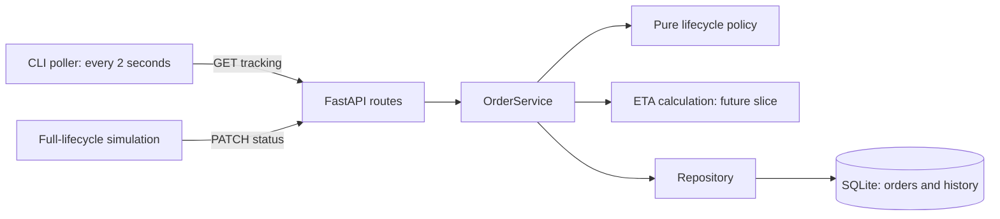
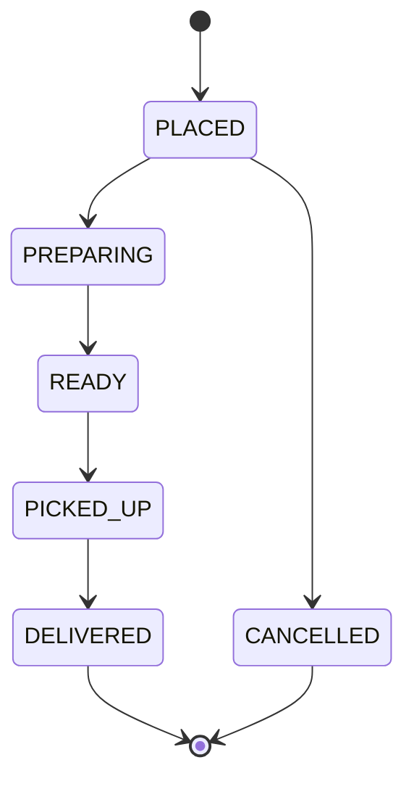

# Track C design

## Slice 4 ETA behavior

Order creation now requires a finite nonnegative numeric `delivery_distance_km`. Travel minutes are `ceil(distance_km * 2)` at 30 km/h. PLACED/PREPARING use `max(0, avg_prep_minutes - elapsed_minutes_since_creation)`; the preparation clock does not restart at PREPARING. The current restaurant preparation value is read during recalculation. READY/PICKED_UP use travel time only. DELIVERED stores the actual transition timestamp as `estimated_delivery_at`; CANCELLED clears that value. `eta_updated_at` records each actual status change, including cancellation. Repeated requests preserve both fields.

Status, history, and ETA writes share one transaction. Tracking derives nonnegative, rounded-up `remaining_minutes` from the stored estimate without writing; delivered returns zero and cancelled returns null. Distances whose estimates exceed Python's supported datetime range return 422 at creation. Pre-ETA schemas are rejected without conversion; migration and legacy-distance policy remain unresolved. No polling or simulation is implemented.

Verification: The full test suite was successfully executed locally with 118 passed, 1 warning.

## Architecture

Preserve FastAPI routes -> services -> repository -> SQLite. The service owns transaction orchestration, lifecycle validation, and ETA calculation. A pure lifecycle policy module supplies the approved status vocabulary and transition classification without importing FastAPI or touching storage. Routes retain request/response and HTTP concerns; repositories retain SQL concerns.

Same-status requests are successful no-ops for every state, including terminal states; they are omitted from the diagram for readability.

## Lifecycle policy contract (slice 1)

`app/order_tracking.py` exposes an immutable `OrderStatus` string enum and `is_status_change(current, requested)`. The function returns `True` for a permitted change, `False` for a known same-status request, and raises `ValueError` for an unknown status or forbidden transition. Unknown values are validated before equality so two identical unknown values cannot succeed. Exact uppercase strings and enum members are accepted; lowercase aliases are not accepted.

This module is a service-layer business policy, not a new architectural tier. Slice 2 will adapt policy failures to the agreed HTTP responses after Pydantic input validation. The current API and schema remain unchanged in slice 1. History and ETA no-op guarantees become integration assertions when those features exist.

## Future transaction and tracking design

After approval of legacy-data handling, creation will atomically insert the order, initial history event, and initial ETA. Status updates will acquire the existing write transaction, read the order, classify the request, and return immediately for a no-op. A real change will atomically write status, a UTC event, and recalculated ETA; an invalid change will write nothing. Keep history events ordered by a stable event sequence to disambiguate timestamp ties. Tracking reads must obtain a consistent snapshot across status, history, and ETA and must never update them.

ETA uses restaurant preparation time plus customer-supplied distance at 30 km/h. A 6 km trip contributes 12 minutes. Input limits, rounding, preparation anchors, persisted payload fields, and terminal ETA semantics await the approvals in requirements D3/D4; no ETA implementation belongs to this iteration.

CLI clients will use standard-library HTTP support to avoid new dependencies. The poller reads tracking every two seconds. The simulation drives all four forward transitions through PATCH rather than editing SQLite. Timeout, retry, terminal-stop, and start-state details remain open in D5/D6.

## ADR-001: Isolate lifecycle policy before API integration

- **Status:** Accepted for this iteration's slice boundary; future integration details remain pending.
- **Context:** Approved Track C states differ from both the current API vocabulary and its SQLite CHECK constraint. A local database exists, but migration and history backfill policies have not been approved. Rewriting the schema now would silently resolve those questions.
- **Decision:** Implement the pure uppercase lifecycle policy first, with exhaustive transition tests. Keep routes/services/repository architecture and the running API intact until slice 2. Use existing Python and pytest only. Never automatically commit or push.
- **Alternatives:** Updating only Pydantic would admit statuses SQLite rejects. Updating API and storage together now would require an unapproved legacy-data policy. Embedding another transition table inside route handlers would split business rules across layers.
- **Consequences:** The first slice is independently testable but does not expose Track C over HTTP yet. Slice 2 must replace the existing service transition table with the tested policy rather than maintain two active policies. Subsequent slices add transactional history, ETA, tracking reads, and scripts with their own tests.
- **Validation:** Test all 36 recognized state pairs, unknown/lowercase values, terminal no-ops, and forward changes. Run the existing API suite to detect regressions. Record results in `docs/tasks.md`.
